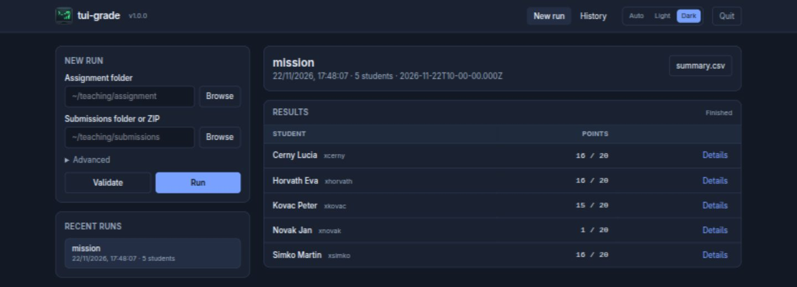

<p align="center">
  
</p>

<h1 align="center">tui-grade</h1>

<p align="center">
  <a href="https://www.npmjs.com/package/tui-grade"></a>
  <a href="https://www.npmjs.com/package/tui-grade"></a>
  <a href="https://github.com/tuplle/tui-grade/actions/workflows/ci.yml"></a>
  <a href="https://tuplle.github.io/tui-grade/"></a>
  <a href="LICENSE.txt"></a>
  <a href="package.json"></a>
  
</p>

A plugin-based framework and command-line tool, `tui-grade`, that **grades student programs written for the terminal**
(command-line tools, text menus, interactive TUIs) by running them against declarative YAML scenarios.

A teacher describes an assignment once: how to build the student's project, what to run, what the program must print or
do, and how the points are split. `tui-grade` then takes a folder of submissions (directories or `.zip` files), builds
each one, runs every scenario in a throw-away work directory, scores the result and writes a machine-readable
`results.json`, a human-readable `report.md` and a `summary.csv` for the whole class.

## Why

- **Scenarios are data, not code.** Checks such as "stdout contains `Help` or `Pomoc`" or "exit code is non-zero" are a
  few lines of YAML. Slovak/English alternatives, negated checks, hidden checks and weights are built in.
- **Two ways to run a program.** A plain *run* (arguments, stdin, stdout/stderr, exit code) and an interactive
  *session* in a real pseudo-terminal (type, press keys, wait for text on the screen), built on
  [`@microsoft/tui-test`](https://www.npmjs.com/package/@microsoft/tui-test).
- **Fair scoring.** Points are grouped (build, arguments, simulation, ...), split by scenario weight and earned by the
  share of passed checks; manually graded groups (e.g. code quality) are merged in from a file.
- **Everything is a plugin.** Steps, checks, builders, reporters and scorers are registered through one small kernel;
  the built-in ones are ordinary plugins, and an assignment can add its own with a few lines of JavaScript.
- **Safe for a batch.** A broken, slow or hostile submission never fails the whole run (see
  [Security](#security)).

## Requirements

- Linux, macOS (arm64 or x64) or Windows **x64**, Node.js **26** or newer. Sessions use
  `@microsoft/tui-test`; Windows ARM64 is not supported by its native package.
- For the example assignments: `gcc` (and `g++` for the C++ ones). On Windows use MinGW/MSYS2 or a `custom`/`cmake`
  builder with a compiler you have.

## Install

**As a dependency of a grading project** (published npm package; a release tarball works the same way):

```bash
pnpm add tui-grade        # or: npm install tui-grade
pnpm exec tui-grade --help
```

The npm package supports Linux, macOS (arm64/x64) and Windows x64. It contains `dist/` plus the compiled dashboard;
dependencies come from the registry.

**From a source checkout** (for development or a local build):

```bash
pnpm install
pnpm build
node dist/cli/main.js --help
```

The CLI also runs directly from source with Node 26 type stripping (`node src/cli/main.ts`); the web dashboard needs
`pnpm build` or `pnpm build:web` for its generated assets.

pnpm 10 and newer refuse to run install scripts that were not approved. For a consumer project the runtime one is
`koffi` (a dependency of the terminal library); its script just looks for a prebuilt binary, so it may stay disabled.
In `pnpm-workspace.yaml`:

```yaml
allowBuilds:
  koffi: false # or true; without a decision `pnpm install` stops with ERR_PNPM_IGNORED_BUILDS
```

This repository also allows `esbuild` (and the existing `@parcel/watcher`) for development; consumers do not install
those dev dependencies.

**As a standalone bundle** (no `npm install`): download `tui-grade-<version>-<platform>-<arch>.tar.gz` from the GitHub
release, unpack it and call the launcher (`tui-grade` on POSIX, `tui-grade.cmd` on Windows). It contains `dist/`, the
production `node_modules` and a launcher; only Node.js 26 has to be present. The archive is built for the platform it
was made on, because the terminal library has a native, platform-specific part.

```bash
tar -xzf tui-grade-1.0.0-linux-x64.tar.gz
./tui-grade/tui-grade --help          # the launcher also works through a symlink: ln -s $PWD/tui-grade/tui-grade ~/bin/
```

The bundle is produced by `pnpm build && node scripts/make-bundle.mjs` (into `bundle/` plus the `.tar.gz`).

## Quickstart (5 minutes)

The repository ships three complete assignments in `examples/`. The mission assignment is the model one: a C17 mission
simulator with 60 scenarios, six point groups and a reference solution.

```bash
pnpm install && pnpm build
alias tui-grade='node dist/cli/main.js'            # or use the bundle / `pnpm exec tui-grade`

# 1. Validate the assignment. No student code is built or started.
tui-grade check examples/mission              # valid: 60 scenarios

# 2. Grade the reference solution (a folder that contains src/main.c).
tui-grade run examples/mission examples/mission/solution --out /tmp/mission-results

# 3. Look at the results.
cat /tmp/mission-results/summary.csv
cat /tmp/mission-results/solution/report.md
```

The solution earns 16 of 20 points; the remaining 4 are the manually graded `quality` group. Give them with a file:

```yaml
# manual.yaml: student id -> group id -> points
solution:
  quality: 3.5
```

```bash
tui-grade run examples/mission examples/mission/solution --out /tmp/mission-results --manual manual.yaml
```

Point `run` at a folder with many submissions (one sub-folder or `.zip` per student) to grade a whole class.

An assignment is a directory:

```
my-assignment/
  assignment.yaml     what to build, groups, scoring, limits, plugins
  scenarios/*.yaml    the scenarios (any depth)
  fixtures/           files the scenarios copy into the work directory (optional)
  plugins/            your own plugins (optional)
```

Continue with [docs/authoring-scenarios.md](docs/authoring-scenarios.md).

## Web dashboard

For a browser-based workflow, run `tui-grade` with no command (after the npm release is published):

```bash
npx tui-grade
```

It starts a server on `127.0.0.1:3333`, prints the URL and opens the default browser. The dashboard can pick an assignment
and a submissions folder or ZIP, validate, run, show live progress, stop a run, inspect student results, enter manual
points and browse earlier runs. It is localhost-only and teacher-only; there is no login and no shared deployment.



```bash
tui-grade serve                      # default: http://127.0.0.1:3333/
tui-grade serve --port 4317          # choose another port
tui-grade serve --no-open            # print the URL without opening a browser
tui-grade serve --results-root ~/.local/share/tui-grade
tui-grade serve --assignment examples/mission --submissions ~/submissions
```

The dashboard runs each batch as a child `tui-grade run` process. The CLI remains the canonical interface and every
command below still works. See [docs/web-ui.md](docs/web-ui.md).

## CLI reference

```
tui-grade                                  # start the localhost web dashboard
tui-grade serve [--port N] [--results-root dir] [--no-open]
tui-grade run <assignment-dir> <path> [--out dir] [--only id,id] [--locale sk|en]
              [--manual file] [--keep-workdirs] [--fail-under N] [--events]
tui-grade rescore <assignment-dir> <out-dir> [--manual file] [--locale sk|en]
tui-grade check <assignment-dir> [--json] [--list]
tui-grade describe [assignment-dir] [--json]
tui-grade schema [assignment-dir]
tui-grade --version
```

| Command | What it does |
| --- | --- |
| `serve` | Starts the localhost dashboard. No command does the same, so `npx tui-grade` opens the browser UI. |
| `run` | Grades every submission found at `<path>`: a folder of submissions, one project folder, or a `.zip`. Prints a points table, writes the results below `--out` (default `<platform data dir>/tui-grade/<timestamp>/`). |
| `rescore` | Recomputes points and regenerates `results.json`, `report.md`, `summary.csv` and student ZIPs from an existing run. Starts no build and no student program. |
| `check` | Validates the assignment: YAML, schemas, unknown steps/checks, `from` references, fixtures, group ids. Starts no build and no student program. `--json` prints `{ ok, issues, scenarios }`; `--list` prints the expanded scenario ids. |
| `describe` | Lists every step, check, builder, reporter and scorer with description, parameters and an example. With an assignment directory it includes the plugins of that assignment. `--json` gives the full parameter schemas. |
| `schema` | Prints a JSON Schema of a scenario file (and of `assignment.yaml` under `$defs`), for editors and AI agents. |

`run` options:

| Option | Meaning |
| --- | --- |
| `--out dir` | Output directory (default `<platform data dir>/tui-grade/<ISO timestamp>`; Linux `~/.local/share/tui-grade`, macOS `~/Library/Application Support/tui-grade`, Windows `%LOCALAPPDATA%\tui-grade`). |
| `--only id,id` | Run only these scenario ids (after matrix expansion); the others are skipped and absent from the results, so the points are split among the selected scenarios only. Meant for debugging. |
| `--locale sk\|en` | Language of the reports; overrides `locale` of `assignment.yaml`. |
| `--manual file` | YAML/JSON file `{ studentId: { groupId: points } }` with the points of manual groups. |
| `--keep-workdirs` | Keep the temporary build/work directories (for debugging; they are removed by default). |
| `--fail-under N` | Exit with 2 when any student has fewer than `N` points. `N` is a non-negative decimal number (`12`, `7.5`). |
| `--events` | Write machine-readable progress as one JSON object per line on stdout; the human points table is suppressed. Used by the web dashboard. |

`tui-grade --version` (or `-v`) prints the version and exits with 0. `Ctrl-C` (`SIGINT`) and `SIGTERM` stop a run cleanly:
the run stops at the next boundary (nothing new is started; every result file that exists is complete, but the file set of the interrupted student may be partial and no `summary.csv` is written; nothing is printed to stdout), terminal sessions are killed
as whole process trees and then every running process group, the temporary directories are removed, and the exit code is
130 / 143. A second `Ctrl-C` while the cleanup runs exits immediately (temp directories may remain). See
[docs/security-and-limits.md](docs/security-and-limits.md) for what cannot be caught.

Exit codes: **0** success; **1** invalid assignment, tool error or bad command line; **2** `--fail-under` not met.
A student's failure (does not compile, crashes, hangs) is never an error of the run: it only costs points.

## Outputs

```
<out>/
  run.json                            teacher-side metadata: assignment directory, input path, start time, locale
  summary.csv                         one row per student: points, max, one column per group (';'-separated)
  manual.yaml                         manual points, when they were entered from the dashboard
  <student>/
    results.json                      the student-facing machine-readable result (schemaVersion 1)
    results.full.json                 teacher-only result with hidden-check details; never packed into the student ZIP
    report.md                         the report for the student, in the chosen locale
    build.log                         output of the build; only written when it is not empty
    screens/<scenario>-<session>.txt  final screen of each terminal session (only for scenarios with a session)
    logs/<scenario>-<run>.txt         exit code, stdout and stderr of each program run (each section capped at 64 KiB)
    <student>-results.zip             report.md, results.json, screens/, logs/ and build.log (if any), to send back to the student
```

The zip is written into the student's own directory and packs the other files of that directory as they were when the
`zip` reporter ran (it runs after `json` and `markdown`); it does not contain `summary.csv` or `results.full.json`.
For the quickstart the tree is `summary.csv`, `run.json` and `solution/{report.md, results.json, results.full.json,
logs/*.txt, screens/*.txt, solution-results.zip}`; the reference solution compiles without output, so there is no
`build.log`.

`run.json` and `results.full.json` are for the teacher. The full result can contain hidden-check expectations; keep it
out of anything you send to students (the built-in ZIP already excludes it).

`<student>` is the id derived from the submission name: with `student_id.pattern` the `id` (or else `login`) group,
otherwise the sanitized file name, at most 100 characters (`summary.csv` is reserved and becomes `summary.csv_`); duplicates get a
`-2`, `-3` suffix. The `source` in `results.json` is reduced to the file name of the submission: no paths of the grading machine.

## Plugins

The kernel knows five kinds of extensions, all registered by name from a plugin function:

| Kind | Used for | Built in (examples) |
| --- | --- | --- |
| step | actions of a scenario | `copy`, `write_file`, `run`, `session`, `script` |
| check | assertions in `expect` | `stdout_contains`, `exit_code`, `screen_matches`, `file_exists`, `function_count`, `any_of`, ... |
| builder | how the project is built (`build.type`) | `gcc`, `cmake`, `custom` |
| scorer | how points are computed (`scoring.use`) | `proportional` |
| reporter | what is written after grading | `json`, `markdown`, `zip`, `csv` |

The built-in plugins form the `default` preset (`preset: none` switches it off). Your own plugins are plain ES modules
listed in `assignment.yaml`:

```yaml
plugins:
  - ./plugins/insert-device.js          # a file in the assignment directory
  - some-npm-plugin                     # a package, resolved from the assignment directory
  - { use: ./plugins/limits.js, options: { max: 3 } }
```

Plugins can also add message catalogs (`app.catalog('sk', { 'my.key': '...' })`) so that the descriptions of their checks
are localized like the built-in ones; built-in messages always win over plugin catalogs.

See [docs/writing-plugins.md](docs/writing-plugins.md). `tui-grade describe <assignment-dir>` always shows what is
available, including your plugins.

## Locale

`locale: sk | en` in `assignment.yaml` (default `en`) chooses the language of the generated reports; `--locale` overrides
it for one run. Titles in `assignment.yaml` and scenarios can be given per language
(`title: { sk: ..., en: ... }`); a missing language falls back to `en`, then to the first one. Messages produced by the
engine itself (for example a check's failure detail) are mostly English.

## Documentation

The documentation site is built with Docsify v5 and hosted on GitHub Pages:
**<https://tuplle.github.io/tui-grade/>**.

- [docs/authoring-scenarios.md](docs/authoring-scenarios.md): `assignment.yaml`, scenarios, steps, checks, groups, hidden checks.
- [docs/writing-plugins.md](docs/writing-plugins.md): the plugin API, hooks, examples and testing.
- [docs/web-ui.md](docs/web-ui.md): the localhost dashboard, manual points and themes.
- [docs/publishing.md](docs/publishing.md): npm tarball, standalone bundle and release workflow.
- [docs/security-and-limits.md](docs/security-and-limits.md): what the tool does and does not protect against.
- [docs/ci-grading-example.yml](docs/ci-grading-example.yml): a sample GitHub Actions workflow for grading.

## Security

Student code is **untrusted, and v1 has no sandbox and no container**. Programs run as the user that started
`tui-grade`, with a timeout, an output cap, their own temporary directory, a minimal environment (plain runs and terminal sessions alike) and a process-group
kill, which keeps ordinary mistakes (infinite loops, endless output, forgotten background jobs) contained but does **not**
stop a deliberately hostile program from reading files, using the network or escaping its process group. Grade
real-world submissions inside a disposable container or VM (for example a CI runner) that holds no secrets. The web
dashboard does not change this: it binds to `127.0.0.1`, has no login, and must not be exposed or proxied. Details and
known limits: [docs/security-and-limits.md](docs/security-and-limits.md).

## Community

- [Contributing](CONTRIBUTING.md): setup, tests, code style and pull requests.
- [Code of Conduct](CODE_OF_CONDUCT.md): expected behavior in project spaces.
- [Security policy](SECURITY.md): private vulnerability reporting.
- [Changelog](CHANGELOG.md): notable changes.
- [Documentation site](https://tuplle.github.io/tui-grade/): the same docs with search and navigation.

## Development

```bash
pnpm install
pnpm check        # typecheck + tests
pnpm verify       # check + build
pnpm build        # dist/ plus the compiled web assets
pnpm build:web    # only the esbuild browser bundle and Tailwind CSS
pnpm bundle       # bundle/ and tui-grade-<version>-<platform>-<arch>.tar.gz (after pnpm build)

pnpm start        # build and start the localhost dashboard
pnpm dev          # build the web assets and run the dashboard from source
pnpm cli check examples/mission  # run the CLI from source
pnpm test:unit    # fast unit, CLI, web, docs and project-file tests
pnpm test:e2e     # compiler/PTY end-to-end tests
pnpm test:packaging
pnpm test:windows # platform-independent Windows x64 smoke tests
pnpm test:watch
pnpm docs         # Docsify at http://localhost:3000
pnpm clean        # remove dist, bundle, _site and release tarballs
```

TypeScript is written as erasable syntax and executed by Node's type stripping in tests; `pnpm build` compiles to
`dist/`, copies the locales and builds the Alpine/Tailwind dashboard into `dist/web/public/` (esbuild bundles `app.js` and Alpine; Tailwind compiles the CSS). CI (`.github/workflows/ci.yml`) runs on Ubuntu and macOS, with a Windows x64
smoke job. A `v*` tag runs `.github/workflows/release.yml`, which publishes the npm package and attaches the npm tarball
and the per-platform standalone bundles to a GitHub release. `.github/workflows/pages.yml` deploys the Docsify
documentation to GitHub Pages.

## License

Apache-2.0, see [LICENSE.txt](LICENSE.txt).
