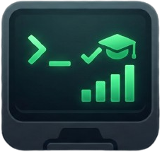

# tui-grade

> Grade student terminal programs with declarative YAML scenarios.

- Plugin-based steps, checks, builders, scorers and reporters
- Plain runs and real pseudo-terminal sessions
- CLI, programmatic API and a localhost teacher dashboard
- Linux, macOS, Windows x64 and Node.js 26

[Get started](quickstart.md)
[CLI reference](cli.md)
[Web dashboard](web-ui.md)
[GitHub](https://github.com/tuplle/tui-grade)
