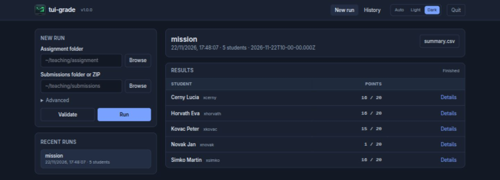
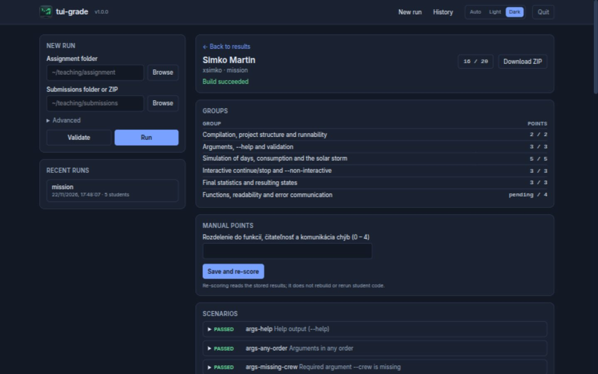

# Web dashboard

`tui-grade` can run as a localhost web app for teachers who prefer a browser to the CLI.

```bash
npx tui-grade
# or:
tui-grade serve
```

The command starts a server on `127.0.0.1:3333`, prints the URL and opens the default browser. `--port 4317` selects
another port, `--no-open` only prints the URL, and `--results-root DIR` changes where runs are stored (default
`$XDG_DATA_HOME/tui-grade` or `~/.local/share/tui-grade` on Linux, `~/Library/Application Support/tui-grade` on macOS,
or `%LOCALAPPDATA%\tui-grade` on Windows). `TUI_GRADE_DATA_DIR` overrides the default; a leading `~` is expanded.

The CLI is unchanged and remains the canonical grading path. Every command in the README still works.





## What the dashboard does

- Pick an assignment folder and a submissions folder or `.zip`.
- Validate an assignment before any build or student program starts.
- Run a batch and watch student/scenario progress live.
- Stop the active run. The dashboard sends an IPC stop message to the child `tui-grade run` process (with `SIGTERM` as
  the fallback), so the normal cleanup and process-tree kill path is used on every platform.
- Inspect the class table and each student's groups, scenarios, checks, build log, run logs, screens and warnings.
- Download `summary.csv` and each student's ZIP.
- Enter manual points for manual groups and re-score without rebuilding or rerunning student code.
- Open earlier runs from the results root.
- Switch between System, Light and Dark themes. The choice is stored in the browser and applied before first paint.

## Run isolation

Each run is a separate child process:

```
tui-grade serve
  └── node dist/cli/main.js run <assignment> <submissions> --out <run> --events
```

The child writes the normal result files and a machine-readable event stream. The server reads that stream for progress
and serves the resulting files. A grading crash therefore fails that run, not the dashboard. One run is active at a time;
a second start returns `409`.

## Teacher-only files

A run directory contains the normal student-facing `results.json` plus:

- `run.json` — assignment directory, input path, start time, locale and version.
- `<student>/results.full.json` — hidden-check details for the teacher.
- `manual.yaml` — manual points entered from the dashboard.

The built-in ZIP reporter excludes `results.full.json`. Do not add it to anything you send to students. `run.json` and
`results.full.json` are teacher-side files, like `summary.csv`.

`tui-grade rescore <assignment-dir> <out-dir> [--manual file]` performs the same re-scoring from the CLI.

## Local access and safety

There is no authentication, by design: this is a single-teacher localhost tool. The server is bound to `127.0.0.1` and
rejects:

- non-local `Host` headers (DNS rebinding);
- state-changing requests without a same-origin `Origin` and the `X-TUI-Grade: 1` header (CSRF);
- cross-origin preflights. No CORS is enabled.

Do not port-forward the server, put it behind a reverse proxy, expose it on a LAN interface or run it on a shared
machine where other users must not control grading. Localhost is not a user boundary.

The dashboard does not change the grading security model: student programs are still untrusted and unsandboxed. Use a
disposable container or VM for real submissions, as described in
[security-and-limits.md](security-and-limits.md).

## Themes

The default is the operating system preference. The header switch offers **Auto**, **Light** and **Dark**; the value
is stored in `localStorage` under `tui-grade-theme`. `theme.js` runs before the stylesheet paints, so a dark reload does
not flash a light page.

The UI is built from Alpine.js and Tailwind CSS. esbuild bundles Alpine into `app.js`; Tailwind compiles the CSS. No CDN
or network access is needed at runtime. Alpine's standard build evaluates its directives with `Function()`, so the CSP
allows `'unsafe-eval'` and Alpine's inline style toggles; inline `<script>` elements are still rejected.

## Development

```bash
pnpm build        # TypeScript, locales and the web assets into dist/
pnpm build:web    # only the dashboard assets
node src/cli/main.ts serve --no-open
```

The server serves `dist/web/public` when it exists, otherwise `src/web/public`. Run `pnpm build:web` after changing
`src/web/public/app.css`, `index.html` or `app.js` if you want Tailwind to regenerate the CSS.
